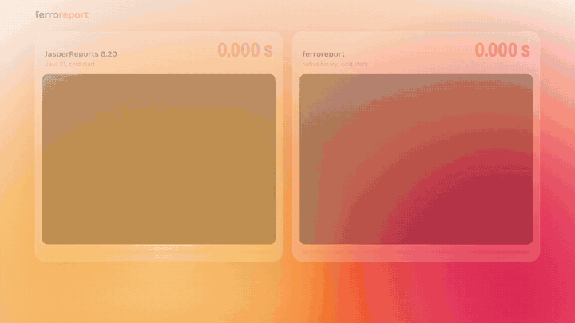

# ferroreport

**Reportes en milisegundos, desde cualquier lenguaje.** ferroreport es un motor de reportes:
le das una plantilla y tus datos y escribe el PDF, el Excel, el CSV o una vista previa web. Una factura tarda
**2 ms**; **un millón de filas** tardan 12 segundos y usan **11 MB de memoria**, porque las
filas se leen a medida que hacen falta y cada página se escribe apenas se termina. Es un solo
binario pequeño, sin nada que instalar, y las plantillas **no pueden ejecutar código** en tu
servidor.

Lee las plantillas de JasperReports (`.jrxml`) que ya tienes y saca el mismo resultado,
**píxel por píxel**: puedes diseñar en Jaspersoft Studio y cambiar de motor sin tocar un
reporte. Frente al propio JasperReports es unas **250 veces más rápido arrancando en frío** y
**de 3 a 6 veces más rápido que una JVM ya caliente** ([los números](#rendimiento)).

<p align="center"><a href="https://cristianencarnacion.github.io/ferroreport/"></a></p>

**[Pruébalo en tu navegador](https://cristianencarnacion.github.io/ferroreport/)** ·
[Descargas](https://github.com/cristianEncarnacion/ferroreport/releases) ·
[Docker](https://github.com/cristianEncarnacion/ferroreport/pkgs/container/ferroreport)

> Estado: **beta, versión 0.10.** Las 40 plantillas comparables de la batería de pruebas salen
> píxel por píxel igual que en JasperReports 6.20, incluyendo bandas divididas entre páginas,
> imágenes, subreportes, tablas, listas, crosstabs, códigos QR y de barras, texto con formato y
> varias columnas; los gráficos siguen de cerca el estilo de JFreeChart. Las 42 también exportan
> el mismo Excel y CSV que Jasper, y las muestras del propio JasperReports se comparan contra
> 6.20.6 y 7.1.1. `ferroreport doctor` te dice si todo lo de tu plantilla está soportado; lo que
> aún falta está en [compatibilidad](README.md#compatibility). Hasta la 1.0 la API todavía puede
> cambiar, y cada cambio va en las notas de la versión. No está afiliado a Jaspersoft ni a Cloud
> Software Group.

## Por qué

- **Rápido y con memoria plana.** Un binario de ~8 MB (con las fuentes incluidas) que arranca
  en milisegundos; importa en CLIs, funciones serverless y contenedores. Las filas entran y
  las páginas salen sin acumularse: un reporte de un millón de filas usa la memoria de uno de
  diez.
- **Salida idéntica.** Cada fixture se renderiza con los dos motores y se compara píxel por
  píxel: hoy los 40 comparables salen idénticos. Sus exportaciones a Excel y CSV se comparan
  celda por celda, y las 42 coinciden.
- **PDF, Excel, CSV y HTML.** La misma plantilla da un PDF, un `.xlsx` armado como el de
  JasperReports (celdas combinadas, fuentes, rellenos, bordes, alturas de fila, imágenes y
  gráficos), un CSV o una página web que se ve como el PDF, para vistas previas.
- **Seguro con plantillas ajenas.** JasperReports compila las expresiones a Java y carga
  archivos `.jasper` serializados; así ocurrieron fallos recientes de ejecución remota de código
  (CVE-2025-10492, CVE-2026-6009). ferroreport nunca deserializa objetos e interpreta las
  expresiones con una lista cerrada de operaciones: sin reflexión, sin carga de clases, sin
  acceso a la red. Las imágenes y subreportes solo se leen de las carpetas de recursos de la
  plantilla, y hay límites de anidamiento, tamaño de imagen, subreportes, páginas y tiempo
  para que una plantilla hostil no agote la memoria ni el procesador. En cada cambio, las
  plantillas de prueba se dañan de miles de formas y el motor debe responder con un documento
  o un error, nunca caerse ([SECURITY.md](SECURITY.md)).
- **Úsalo desde cualquier lenguaje.** Paquetes para JavaScript (Node.js, Deno, Bun y
  navegadores), Python y Java (Quarkus, Spring; lee un `ResultSet` fila por fila, ver
  [bindings/java](bindings/java/README.md)), librería de Rust, CLI, y una API HTTP en imagen
  Docker para todo lo demás (C#, PHP, Go, Ruby...). El servidor no escucha fuera de localhost
  sin token.

## Desde tu lenguaje

> **[Documentación completa](https://cristianencarnacion.github.io/ferroreport/docs.html)** (en inglés): cada comando,
> endpoint, función y opción. El [paquete de npm](https://www.npmjs.com/package/ferroreport), los
> [binarios de Releases](https://github.com/cristianEncarnacion/ferroreport/releases) y la imagen Docker ya están disponibles.
> Los [crates](https://crates.io/crates/ferroreport) también; el paquete de PyPI se está publicando.

- **JavaScript/TypeScript:** `npm install ferroreport` y
  `render(plantilla, filas, parametros, { locale: "es_DO" })` devuelve el PDF; con
  `{ format: "xlsx" }` o `"csv"`, el Excel o el CSV.
- **Python:** `pip install ferroreport` y
  `ferroreport.render("factura.jrxml", filas, parametros, locale="es_DO")` (agrega
  `format="xlsx"` o `"csv"`, o usa `render_to_file(..., "factura.xlsx", ...)`).
- **Cualquier lenguaje por HTTP:**
  `docker run -p 8080:8080 -v "$PWD/plantillas:/templates" -e FERROREPORT_TEMPLATES=/templates -e FERROREPORT_TOKEN=cambiame ghcr.io/cristianencarnacion/ferroreport`
  y luego `POST /render/factura` con `Authorization: Bearer cambiame` y
  `{"data": [...], "params": {...}}` te devuelve el PDF (agrega `"format": "xlsx"`, `"csv"` o
  `"html"` para Excel, CSV o una vista previa web). Para reportes con más filas de las que
  quieres en memoria, envíalas una por línea (`Content-Type: application/x-ndjson`: la
  petición en la primera línea y una fila en cada línea siguiente) y el servidor las lee a
  medida que el reporte las necesita: un millón de filas con el servidor en unos 45 MB. La
  respuesta es el documento completo o un error, nunca medio PDF; con
  `Prefer: respond-streaming` llega mientras se genera (primeros bytes al instante, y si el
  cliente se va, el reporte se detiene).
- **Java:** `Ferroreport.local().template(Path.of("factura.jrxml")).rows(lineas).param("CLIENTE", "Caribe").render()`;
  con `.rows(resultSet).renderTo(Path.of("ventas.pdf"))` un query va directo al archivo sin
  cargarse en memoria.
- **Rust:** `cargo add ferroreport`. **Línea de comandos:** binarios en
  [Releases](https://github.com/cristianEncarnacion/ferroreport/releases); `-d -` y `-o -` leen
  las filas de stdin y escriben el PDF en stdout.

## Inicio rápido

```bash
cargo install --path crates/ferroreport-cli

ferroreport render factura.jrxml --data filas.json --params parametros.json -o factura.pdf --locale es_DO
ferroreport render factura.jrxml --data filas.json -o factura.xlsx   # Excel (o .csv)
ferroreport doctor factura.jrxml     # qué soporta (y qué no) esta plantilla
```

`filas.json` es un arreglo JSON de objetos, o un objeto JSON por línea, cuyas claves coinciden
con los `<field>` de la plantilla. El archivo se lee a medida que el reporte lo necesita y cada
página se escribe apenas se termina, así que puede ser mucho más grande que la memoria;
`--max-pages` y `--timeout` detienen un reporte que crece más de lo esperado. Los valores se convierten a la clase que declara cada campo (`BigDecimal`, fechas
ISO-8601 a `java.util.Date`, arreglos anidados a `java.util.List`, base64 a `byte[]`, etc.).

Las imágenes y subreportes se buscan junto a la plantilla (agrega más carpetas con
`--resources CARPETA`). Un subreporte que apunta a `lineas.jasper` se renderiza desde
`lineas.jrxml`: nunca se cargan archivos `.jasper` compilados. Los arreglos JSON anidados
alimentan subreportes, por ejemplo `new JRMapCollectionDataSource($F{lineas})` o
`((JsonDataSource)$P{REPORT_DATA_SOURCE}).subDataSource("lineas")`.

## Qué soporta

- Bandas completas, incluida la división de bandas y frames entre páginas (`splitType`), y un
  título que no cabe en una página y sigue en las siguientes, como en JasperReports.
- Texto estático y dinámico, líneas, rectángulos, elipses, frames, imágenes PNG, JPEG y GIF,
  subreportes, icon labels, y códigos de los componentes barcode4j: QR, DataMatrix, Code 128,
  EAN-128, Code 39 (con ASCII completo), EAN-13, EAN-8, UPC-A, UPC-E, Interleaved 2 of 5,
  Codabar, POSTNET, Royal Mail y USPS Intelligent Mail. Cada barra se verifica contra barcode4j.
- Campos de formulario PDF (`net.sf.jasperreports.export.pdf.field.*`): texto, listas
  desplegables, casillas y botones de opción.
- Estilos con herencia y estilos condicionales, texto justificado, `isRemoveLineWhenBlank`,
  `isPrintRepeatedValues`, grupos, variables y tiempos de evaluación.
- Los QR se codifican igual que ZXing (misma versión, máscara y módulos) y se dibujan como los
  dibuja JasperReports: sirven para facturas electrónicas impresas, como el sello del e-CF
  dominicano.
- Reportes de varias columnas (orden vertical y horizontal).
- Texto con formato (markup `styled`, `html` y `rtf`): negritas, cursivas, fuentes, tamaños,
  colores, resaltado, superíndices, saltos de línea y listas HTML (con viñetas o numeradas, una
  dentro de otra), también cuando el texto sigue en otra página.
- Texto sin fuente disponible escrito como lo escribe JasperReports: en la fuente estándar del PDF
  que diga su `pdfFontName` (Helvetica por defecto).
- Texto rotado (izquierda, derecha, de cabeza).
- Gráficos: pastel (también 3D), barras (también 3D y apiladas), líneas, áreas, XY, dispersión,
  burbujas, series de tiempo, velas (candlestick), máximo-mínimo, Gantt, medidor, termómetro y
  de varios ejes, con títulos, leyendas y datasets por registro, grupo o reporte, también desde un
  subdataset. Siguen el estilo de JFreeChart, aunque no son idénticos píxel por píxel.
- Tablas (`jr:table`) como las crea el asistente de Jaspersoft Studio: grupos de columnas, encabezados
  y pies de tabla, de columna y de grupo, columnas ocultas, celda sin datos, y encabezados que se
  repiten en cada página.
- Listas (`jr:list`) verticales y horizontales, también cuando siguen en otra página.
- Exportación a Excel (XLSX) y CSV como la de JasperReports con su configuración por defecto: todas
  las páginas en una hoja con el nombre del reporte, cada texto en las celdas que cubre
  (combinadas) con su fuente, colores, bordes y alineación; líneas como bordes, imágenes sobre sus
  celdas, y gráficos y códigos de barras como imágenes (al doble de resolución que Jasper). Los
  valores van como texto formateado, igual que en Jasper; con `--xlsx-numbers` los números van
  como números con su formato.
- Crosstabs (tablas cruzadas): grupos de filas y columnas con totales al inicio o al final,
  varias medidas (suma, conteo, promedio, máximo, mínimo...), porcentajes del total general,
  orden por totales (`orderByExpression`), totales con `$V{medida_grupo_ALL}`,
  parámetros, datos del reporte o de un subdataset. Si no caben a lo ancho se parten en bloques de
  columnas, y si no caben a lo alto siguen en la página siguiente con las cabeceras repetidas.
- PDF etiquetado para lectores de pantalla (`--tagged`): párrafos y títulos, imágenes con su
  descripción, tablas y crosstabs con celdas de encabezado y las columnas y filas que abarca
  cada celda, y listas HTML como listas.
- Aún no: comparadores propios en crosstabs, PDF417, códigos Barbecue, personalizadores de
  gráficos, conexiones JDBC.
  La tabla completa está en el [README en inglés](README.md#compatibility).

## Rendimiento

Cuánto más rápido es depende de con qué se compare, así que aquí están las tres comparaciones
que importan, todas contra JasperReports 6.20.6 en Java 21 y en la misma máquina Linux de
2 CPU. Un solo comando lo reproduce todo: `tools/bench_all.py` (resultados en
[docs/benchmarks.json](docs/benchmarks.json)).

**En frío: un proceso que arranca, genera un reporte y termina.** Lo que paga un script, una
función serverless o un contenedor por reporte. Tiempo desde que arranca el proceso hasta el
PDF en disco, y memoria pico (mediana de 5 a 7 corridas):

| Reporte | JasperReports | ferroreport | Más rápido |
|---|---|---|---|
| Factura, 2 páginas | 2.98 s, 190 MiB | 11 ms, 10 MiB | 274× |
| Ventas agrupadas, 4 páginas | 3.13 s, 184 MiB | 13 ms, 11 MiB | 245× |
| 20,000 filas, 477 páginas | 6.44 s, 461 MiB | 0.26 s, 10 MiB | 25× |

**En caliente: un servicio que se queda encendido.** JasperReports en su mejor caso: una sola
JVM, la plantilla compilada una vez, el JIT calentado con cientos de corridas, las filas ya
convertidas a objetos Java y el PDF exportado a memoria. ferroreport hace el trabajo completo
cada vez (también interpreta la plantilla). Mediana por reporte:

| Reporte | JasperReports | ferroreport | Más rápido |
|---|---|---|---|
| Factura, 2 páginas | 8.2 ms | 2.2 ms | 3.8× |
| Lista de empleados, 2 páginas | 6.2 ms | 1.3 ms | 4.7× |
| Ventas agrupadas, 4 páginas | 11.8 ms | 3.6 ms | 3.3× |
| 20,000 filas, 477 páginas | 1258.7 ms | 206.1 ms | 6.1× |

**Muchos a la vez: un servicio con carga.** La misma JVM en caliente y el mismo ferroreport,
ahora con varios hilos generando la factura al mismo tiempo durante 8 segundos, en 2 CPU
(`tools/bench_concurrent.py`, resultados en
[docs/benchmarks-concurrent.json](docs/benchmarks-concurrent.json)):

| Hilos | Reportes/s, JasperReports | Reportes/s, ferroreport | 95% en menos de, JasperReports | 95% en menos de, ferroreport | Memoria, JasperReports | Memoria, ferroreport |
|---|---|---|---|---|---|---|
| 1 | 100 | 442 | 15 ms | 4 ms | 317 MiB | 10 MiB |
| 2 | 136 | 869 | 25 ms | 3 ms | 382 MiB | 11 MiB |
| 10 | 151 | 942 | 104 ms | 22 ms | 467 MiB | 18 MiB |
| 50 | 143 | 893 | 884 ms | 131 ms | 655 MiB | 58 MiB |
| 100 | 160 | 957 | 1834 ms | 318 ms | 812 MiB | 90 MiB |

Entre cuatro y seis veces más reportes por segundo con cualquier carga, el 95% listo entre
cuatro y ocho veces antes, con entre la novena y la treintava parte de la memoria. Por HTTP, `ferroreport serve`
responde una factura en unos 3 ms sobre una conexión que se mantiene abierta.

**Grandes: filas por cientos de miles.** El mismo reporte con más filas, en frío, y
JasperReports con su memoria por defecto. ferroreport lee las filas a medida que las necesita
y escribe cada página al terminarla, así que su memoria no crece con el reporte:

| Reporte | JasperReports | ferroreport | Más rápido | Menos memoria |
|---|---|---|---|---|
| 100,000 filas, 2,382 páginas | 12.38 s, 679 MiB | 1.27 s, 10 MiB | 9.7× | 70× |
| 1,000,000 filas, 23,810 páginas | 70.06 s, 1,731 MiB | 11.79 s, 11 MiB | 5.9× | 151× |

En resumen: en un reporte pequeño, casi todo el tiempo de JasperReports se va en arrancar la
JVM y compilar la plantilla, por eso la diferencia es de dos órdenes de magnitud cuando arranca
un proceso por reporte y de 3 a 6 veces cuando no. Los PDF además suelen pesar menos (1.2 MB
en vez de 4.5 MB con 20,000 filas; más o menos lo mismo con un millón). Los libros de Excel también se escriben a medida que se generan: las columnas de la hoja
salen de todas las páginas, así que un reporte grande se llena dos veces, una para encontrarlas
y otra para escribir las filas (100,000 filas: unos 3 s y 58 MiB; 500,000: 17 s y 92 MiB). Un
reporte con más filas de las que caben en una hoja (1,048,576) se detiene con un error que lo dice.

## Roadmap

- **Fase 2 (en curso):** listo: división de bandas, imágenes, subreportes, estilos
  condicionales, texto justificado, códigos QR y de barras, multicolumna, texto con formato, texto rotado, gráficos
  tablas, listas y crosstabs, memoria constante en reportes enormes (las filas entran y las
  páginas salen sin acumularse), límites de páginas y tiempo, pruebas de mutación.
- **Fase 3:** paquetes para npm y PyPI, versión WebAssembly con playground en el navegador y
  vista previa en vivo para VS Code.
- **Fase 4:** listo: exportación a Excel (XLSX) y CSV, todos los tipos de gráfico de JasperReports.
- **Listo en 0.10:** los nueve tipos de gráfico que faltaban, markup RTF, listas HTML, DataMatrix,
  EAN-128, UPC-E y códigos postales, campos de formulario PDF, icon labels, Helvetica para el
  texto sin fuente, listas y celdas combinadas en PDF etiquetado, títulos de varias páginas;
  verificado también contra las muestras de JasperReports 7.1.1.
- **Listo en 0.8:** salida HTML para vistas previas, librería de Java que lee un `ResultSet`
  fila por fila, filas desde cualquier base de datos por tubería o iterador, y un servidor que
  se niega a quedar abierto a la red y puede limitar a cada cliente.
- **Siguiente:** un formato de plantilla propio, corto y legible como Markdown, que se compila al
  mismo motor y es accesible por defecto; `ferroreport convert` entre ese formato y JRXML (y de
  JRXML 6 a 7); la librería de Java en Maven Central (hoy la construye JitPack), Excel escrito
  por partes, salida a Word, PDF417 y un diseñador visual (mientras tanto, Jaspersoft Studio
  sirve para diseñar las plantillas).

La documentación completa (compatibilidad, cómo se verifica la salida, cómo contribuir) está en
el [README en inglés](README.md).

## Licencia

MIT o Apache-2.0, a tu elección. Las fuentes DejaVu incluidas tienen su propia licencia.
JasperReports y Jaspersoft son marcas de Cloud Software Group, Inc.; este proyecto es
independiente.
