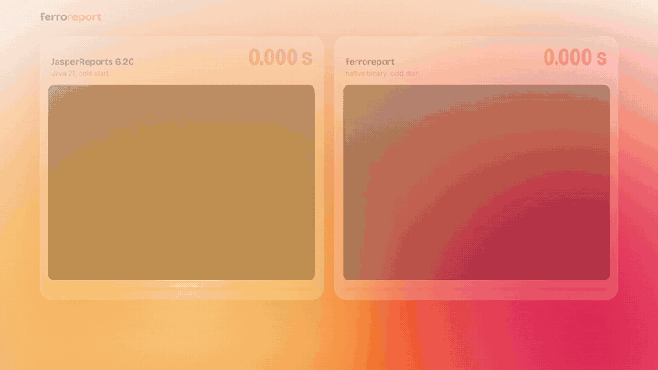

# ferroreport

**Reports in milliseconds, from any language.** ferroreport is a report engine: give it a
template and your data and it writes the PDF, the Excel workbook, the Word document, the CSV or
a web preview. An invoice takes
**2 ms**; a **million rows** take 12 seconds and **11 MB of memory**, because rows are read as
they are needed and pages are written as they are finished. It is one small binary with no
runtime to install, and templates **cannot run code** on your server.

It reads the JasperReports templates (`.jrxml`) you already have and gives the same output,
**pixel for pixel**, so you can design in Jaspersoft Studio and switch engines without touching
a report. Or write templates in [its own format](#templates-jrxml-or-ferro), half the size of
JRXML and accessible by default. Against JasperReports itself it is about **250× faster from a cold start** and
**3 to 6× faster than a JVM that is already warm** ([the numbers](#performance)).

<p align="center"><a href="https://cristianencarnacion.github.io/ferroreport/"></a></p>

**[Try it in your browser](https://cristianencarnacion.github.io/ferroreport/)** ·
[Download](https://github.com/cristianEncarnacion/ferroreport/releases) ·
[Docker](https://github.com/cristianEncarnacion/ferroreport/pkgs/container/ferroreport) ·
[Leer en español](README.es.md)

> Status: **beta, version 0.11.** All 42 comparable test templates render pixel for pixel like
> JasperReports 6.20, including band splitting, images (SVG too), subreports, tables, lists,
> crosstabs, QR, PDF417 and other barcodes, styled text and multi-column layouts; charts follow
> JFreeChart's look closely. All 44 also export the same Excel and CSV files as Jasper, every
> tagged PDF passes veraPDF's PDF/UA-1 checks, and JasperReports' own samples are checked
> against 6.20.6 and 7.1.1. `ferroreport doctor` tells you whether everything in your template is supported; what
> is not yet is listed under [compatibility](#compatibility). Until 1.0 the API can still
> change, and every change is in the release notes. Not affiliated with Jaspersoft or Cloud
> Software Group.

## Why

- **Fast, and flat in memory.** One ~8 MB binary (fonts included) that starts in milliseconds,
  which matters for CLIs, serverless functions and containers. Rows stream in and pages stream
  out: a report of a million rows uses the memory of a report of ten.
- **Identical output.** Every fixture is rendered by both engines and compared pixel by pixel,
  and its Excel and CSV exports cell by cell (see [how output is verified](#how-output-is-verified)).
- **PDF, Excel, Word, CSV and HTML.** The same template gives a PDF (tagged for screen readers
  if you want, PDF/UA-1), an `.xlsx` workbook laid out like JasperReports' (merged cells, fonts,
  fills, borders, row heights, images, charts), a `.docx` laid out like Jasper's Word export, a
  CSV, or a web page that looks like the PDF, for previews in a browser.
- **Safe with untrusted templates.** JasperReports compiles template expressions to Java and
  loads serialized `.jasper` files, which is how recent remote-code-execution bugs happened
  (CVE-2025-10492, CVE-2026-6009). ferroreport never deserializes objects and interprets
  expressions from a fixed allow-list: no reflection, no class loading, no network access. Images
  and subreports are only read from the template's resource directories, and limits on nesting,
  image size, subreports, pages and time keep a hostile template from exhausting memory or time.
  Every push mutates each test template thousands of ways and requires an error or a document,
  never a crash ([SECURITY.md](SECURITY.md)).
- **JRXML, or a format of its own.** Templates from Jaspersoft Studio work as they are (JRXML 6
  and 7). New ones can be written in `.ferro`, an outline a person can read and write by hand,
  and `ferroreport convert` turns one into the other, and JRXML 6 into 7.
- **Use it from any language.** Packages for JavaScript (Node.js, Deno, Bun, browsers), Python
  and Java, a Rust library, a CLI, and an HTTP API in a Docker image for everything else (C#,
  PHP, Go, Ruby...).

## Use it from your language

> **[Full documentation](https://cristianencarnacion.github.io/ferroreport/docs.html)**: every command, endpoint, function and option.
> Available now: the [npm package](https://www.npmjs.com/package/ferroreport), the
> [crates](https://crates.io/crates/ferroreport), the
> [release binaries](https://github.com/cristianEncarnacion/ferroreport/releases) and the Docker image.
> The PyPI package is being published.

**JavaScript / TypeScript** (Node.js, Deno, Bun, browsers): `npm install ferroreport`

```js
import { render, convert } from "ferroreport";
const pdf = render(jrxmlSource, rows, { CUSTOMER: "Distribuidora Caribe" }, { locale: "es_DO" });
const xlsx = render(jrxmlSource, rows, params, { format: "xlsx" }); // or "docx", "csv"
const ferro = convert(jrxmlSource, "ferro"); // the template in ferroreport's own format
```

**Python**: `pip install ferroreport`

```python
import ferroreport
pdf = ferroreport.render("invoice.jrxml", rows, {"CUSTOMER": "Distribuidora Caribe"}, locale="es_DO")
ferroreport.render_to_file("invoice.jrxml", "invoice.xlsx", rows)  # format from the extension
# A file of rows larger than memory, written page by page:
ferroreport.render_to_file("sales.jrxml", "sales.pdf", data_file="sales.jsonl")
```

**Java** (Quarkus, Spring, plain Java 11+; [details](bindings/java/README.md)):

```java
Ferroreport reports = Ferroreport.local();
byte[] pdf = reports.template(Path.of("invoice.jrxml")).rows(lines).param("CUSTOMER", "Caribe").render();
// A query straight to a file, in constant memory:
reports.template(Path.of("sales.jrxml")).rows(resultSet).renderTo(Path.of("sales.pdf"));
```

**Any language, over HTTP** (C#, PHP, Go, Ruby...):

```bash
docker run -p 8080:8080 -v "$PWD/templates:/templates" -e FERROREPORT_TEMPLATES=/templates \
  -e FERROREPORT_TOKEN=change-me ghcr.io/cristianencarnacion/ferroreport

curl -X POST localhost:8080/render/invoice -H 'Authorization: Bearer change-me' -H 'Content-Type: application/json' \
  -d '{"data": [{"item": "Cemento", "amount": 395}], "params": {"CUSTOMER": "Caribe"}}' -o invoice.pdf
```

`POST /render` also accepts the template itself (`{"template": "<jasperReport...", "data": ...,
"resources": {"logo.png": "<base64>"}}`); add `"format": "xlsx"`, `"docx"`, `"csv"` or `"html"` (or
`?format=xlsx`) for Excel, Word, CSV or a web preview. `POST /inspect` reports unsupported features, `GET /health` is there for
load balancers and `GET /metrics` for Prometheus. The server will not listen beyond localhost
without a token (`FERROREPORT_TOKEN`), unless you say the port is private
(`FERROREPORT_ALLOW_ANONYMOUS=1`); `--rate-limit` caps the requests per minute of one client. Templates are parsed once and cached, and every render runs under a time limit (60 s
unless you change `--timeout`) and, if you set `--max-pages`, a page limit.

For reports with more rows than you want in memory, send them one per line
(`Content-Type: application/x-ndjson`: the request on the first line, a row on each line after
it) and the server reads them as the report needs them: a million rows with the server at
about 45 MB. The answer is the whole document or an error, never half a PDF; add
`Prefer: respond-streaming` to get it as it renders instead (first bytes at once, and a client
that leaves stops the render). [How both work](https://cristianencarnacion.github.io/ferroreport/docs.html#http-large).

**Rust**: `cargo add ferroreport` (example below). **Command line**: download a binary from
[Releases](https://github.com/cristianEncarnacion/ferroreport/releases) or `cargo install
ferroreport-cli`; `-d -` and `-o -` read rows from stdin and write the PDF to stdout, which
makes it easy to call from scripts.

Language packages are published by the [release workflow](RELEASING.md).

## Quick start

```bash
cargo install --path crates/ferroreport-cli

ferroreport render invoice.jrxml --data rows.json --params params.json -o invoice.pdf
ferroreport render invoice.jrxml --data rows.json -o invoice.xlsx   # Excel (or .docx, .csv, .html)
ferroreport doctor invoice.jrxml     # what in this template is (not yet) supported
ferroreport convert invoice.jrxml -o invoice.ferro   # the same template in ferroreport's format
```

`rows.json` is a JSON array of objects, or one JSON object per line, whose keys match the
template's `<field>` names (dotted names such as `customer.name` reach into nested objects).
The file is read as the report needs it and each page is written as it is finished, so it can
be far larger than memory; `--max-pages` and `--timeout` stop a report that grows past what
you expect. Values are converted to the
class each field declares (`java.math.BigDecimal`, `java.util.Date` from ISO-8601 strings,
`java.util.List` from nested arrays, `byte[]` from base64, ...).

Images and subreports are looked up next to the template (add more directories with
`--resources DIR`). A subreport that names `lines.jasper` is rendered from `lines.jrxml` (or
`lines.ferro`): compiled `.jasper` files are never loaded. Nested JSON arrays feed subreports, for example
`new JRMapCollectionDataSource($F{lines})` or
`((JsonDataSource)$P{REPORT_DATA_SOURCE}).subDataSource("lines")`.

As a library:

```rust
let template = std::fs::read_to_string("invoice.jrxml")?;
let rows: serde_json::Value = serde_json::from_str(&std::fs::read_to_string("rows.json")?)?;
let pdf = ferroreport::Renderer::new()
    .locale("es_DO")
    .render_json(&template, &rows, &serde_json::json!({ "CUSTOMER": "Distribuidora Caribe" }))?;
std::fs::write("invoice.pdf", pdf)?;
// Excel or CSV: render_json_as(&template, &rows, &params, ferroreport::Format::Xlsx)
```

For large reports, give it the rows as they come and somewhere to write, and nothing is held
in memory but the page being filled:

```rust
let report = ferroreport::parse(&template)?;          // parse once, render many times
let rows = ferroreport::JsonRows::new(&report, std::fs::File::open("sales.json")?);
let out = std::io::BufWriter::new(std::fs::File::create("sales.pdf")?);
let stats = ferroreport::Renderer::new()
    .limits(ferroreport::Limits { max_pages: Some(50_000), timeout: Some(std::time::Duration::from_secs(120)) })
    .render_to(&report, Box::new(rows), Default::default(), ferroreport::Format::Pdf, out)?;
println!("{} pages from {} rows", stats.pages, stats.rows);
```

`rows` is any iterator of records, so they can come from a database cursor or a queue just as
well; and `fill_to` hands each finished page to a `PageSink` of your own.

### Rows from a database

The engine does not open database connections: your application already has one, with its
credentials and its pool. Hand it the rows as they come and nothing is held in memory.

```bash
# PostgreSQL: one JSON object per row, straight into the report
psql -At -c "select row_to_json(s) from (select * from sales order by region) s" mydb \
  | ferroreport render sales.jrxml -d - -o sales.pdf

# SQLite and MySQL
sqlite3 -json app.db "select * from sales order by region" | ferroreport render sales.jrxml -d - -o sales.pdf
mysql -N -B -e "select json_object('region', region, 'amount', amount) from sales" mydb \
  | ferroreport render sales.jrxml -d - -o sales.pdf
```

```java
// Java: the ResultSet is read as the report needs it
reports.template(Path.of("sales.jrxml")).rows(statement.executeQuery("select * from sales")).renderTo(Path.of("sales.pdf"));
```

```python
# Python: any cursor or generator
cursor.execute("select region, amount from sales order by region")
rows = (dict(zip(("region", "amount"), r)) for r in cursor)
ferroreport.render_to_file("sales.jrxml", "sales.pdf", rows)
```

Templates with an embedded SQL query do not run it: send the rows.

### Excel and CSV

The XLSX and CSV exports follow JasperReports' own exporters with their default settings, so a
spreadsheet made from a template looks the way it did with Jasper:

- All pages go on one sheet named after the report. Element edges and page margins cut the page
  into columns and rows; each text takes the cells it covers (merged), with its font, colors,
  borders, alignment and rotation; styled and HTML text keeps its runs.
- Lines become cell borders, rectangles and frames fill and outline their cells, and images sit
  over their cells with the same scale mode and alignment. Charts and barcodes are drawn as
  pictures (at twice Jasper's resolution, so they stay sharp).
- Values are written as the formatted text, like Jasper. Pass `--xlsx-numbers` (or
  `XlsxOptions { detect_cell_type: true }`) to write numbers as numbers with their format.
- CSV has one row for every line where a text starts, and one field for every column where a
  text starts on that page.

## Templates: JRXML or .ferro

ferroreport reads JRXML as JasperReports 6 and 7 write it, and a format of its own, `.ferro`:
the same reports, written as an indented outline instead of XML. It is about half the size of
the JRXML, a person can write it without a designer, and its reports are accessible by default.

```text
report "Employees" lang=en
  style Base default fontName="DejaVu Sans" fontSize=10
  field name String
  field salary Double
  variable total Double calculation=Sum : $F{salary}

  title 40
    h1 0,0 555x30 fontSize=18 : Employees
  columnHeader 20
    staticText 0,0 300x20 bold : Name
    staticText 300,0 255x20 bold hTextAlign=Right : Salary
  detail 20
    textField 0,0 300x20 : $F{name}
    textField 300,0 255x20 pattern=#,##0.00 hTextAlign=Right : $F{salary}
  summary 20
    textField 300,0 255x20 bold hTextAlign=Right : $V{total}
```

Each line is one part of the report: what it is (for an element, its kind), then its position
and size (`x,y` and `widthxheight`), its attributes (`name=value`, quoted when the value has
spaces; a name alone means `true`), and after ` : ` its text or expression. The lines indented
under it are inside it. A band's height follows its name, and `detail 20` is a detail band 20
points tall. Fields, parameters and variables take their name and class (`String`,
`BigDecimal`, `Date`... need no package). A report is A4 with 20-point margins unless it says
`page=Letter` (or `A3`, `A5`, `Legal`, `612x792`), `landscape` or `margins=30`. A text over
several lines goes under a line that ends in ` :`, one level further in. Lines that start with
`//` are comments. Everything JRXML 7 can say, `.ferro` can say: what has no shorthand keeps
its JRXML name (`box`, `pen lineWidth=0.5`, `component`...).

**Accessible by default.** A `.ferro` report produces a tagged PDF that screen readers can
follow (unless it says `tagged=false`), in the language of `lang=`. `h1` to `h6` are headings,
`alt="..."` describes an image, and `tag=th` (or any other tag) says what an element is.

`ferroreport convert` turns one format into the other, and JRXML 6 into JRXML 7:

```bash
ferroreport convert invoice.jrxml -o invoice.ferro     # JRXML 6 or 7 -> .ferro
ferroreport convert invoice.ferro -o invoice.jrxml     # .ferro -> JRXML 7 (Jaspersoft Studio 7 opens it)
ferroreport convert old.jrxml --to jrxml -o new.jrxml  # JRXML 6 -> JRXML 7
```

Every way of rendering reads `.ferro` like JRXML: the CLI (`ferroreport render invoice.ferro`),
the packages (pass the template's text or file), the server (`POST /render/invoice` finds
`invoice.ferro` when there is no `invoice.jrxml`), subreports and style templates. The Python
and JavaScript packages have `convert(template, to)` too.

How the conversions are checked: JasperReports ships its samples written in JRXML 6 (6.20)
and in JRXML 7 (7.1.1, converted by JasperReports' own tools). `tools/convert_check.py`
converts the 123 samples that are in both and compares the result with JasperReports' own
JRXML 7: 89 are the same, and the other 34 are samples that were edited between the two
releases (a text, a margin, a property added), apart from one custom component of a sample's
own. All 171 JRXML 7 samples go to `.ferro` and back unchanged (two with their properties in
another order). Every fixture renders to the same pixels from its JRXML, its JRXML 7 and its
`.ferro`, and JasperReports 7.1.1 renders the converted fixtures.

## Compatibility

| Area | Supported | Not yet |
|---|---|---|
| Templates | JRXML 6.x schema; JRXML 7 as JasperReports 7 writes it; `.ferro` (ferroreport's own format), with `ferroreport convert` between them; subdatasets (for tables); style templates (`<template>`, `.jrtx` files, with the templates they include, found next to the report or in a resource folder) | `.jasper` files (by design), scriptlets, subdataset queries |
| Bands | title (going on over several pages when it does not fit one, as in JasperReports), page header/footer, column header/footer, detail (multiple bands), summary, no data, background, last page footer; splitting bands across pages (`splitType` Stretch, Prevent, Immediate); multi-column layout (vertical and horizontal print order, `isStartNewColumn`, column breaks); with no rows and `AllSectionsNoDetail`, group headers and footers print once | |
| Elements | static text, text field, line, rectangle (rounded), ellipse, frame (split across pages), image (PNG, JPEG or GIF from files, base64 or `byte[]`), subreport, crosstab (row and column groups with totals at the start or end, header positions, several measures with Sum, Count, DistinctCount, Average, Highest, Lowest and First, percentages of the grand total (`percentageOf`), buckets ordered by a total (`orderByExpression`), `$V{measure_group_ALL}` totals, crosstab parameters, data from the report or a subdataset; column parts as wide as the element and rows continuing on the next pages with repeated headers), table component (column groups, table/column/group headers and footers, hidden columns, no-data cell, headers repeated on every page), list component (vertical and horizontal), icon label, charts, barcodes (barcode4j components: QR code, DataMatrix, PDF417, Code 128, EAN-128, Code 39 with full ASCII, EAN-13, EAN-8, UPC-A, UPC-E, Interleaved 2 of 5, Codabar, POSTNET, Royal Mail and USPS Intelligent Mail), PDF form fields (`net.sf.jasperreports.export.pdf.field.*`: text, combo and list boxes, check boxes, radio buttons), page break (applied after its band) | crosstab bucket comparators, crosstabs over a group's rows, UPC/EAN add-ons, rotated barcodes, Barbecue barcodes, maps and other custom components |
| Text | wrapping, stretch with overflow, padding, borders, left/center/right/justified alignment, all line-spacing modes, underline, strike-through, `isBlankWhenNull`, styled, HTML and RTF markup (bold, italic, underline, strike-through, fonts, sizes, colors, highlight, superscript, subscript, line breaks; HTML lists, bulleted and numbered, nested), also across page breaks; rotation (Left, Right, UpsideDown); cutting a text that does not fit at a character and with a suffix (`net.sf.jasperreports.text.truncate.*`) | |
| Layout | `positionType` Float / FixRelativeToBottom, `stretchType`, `printWhenExpression`, `isRemoveLineWhenBlank`, `isPrintRepeatedValues` (with `isPrintInFirstWholeBand`, `printWhenGroupChanges`), `isPrintWhenDetailOverflows` | |
| Styles | default style (also what styles without a parent inherit from), parent styles, element overrides, conditional styles (up to 4 per style), styles from style templates (a style defined again replaces the earlier one for what comes after, as in JasperReports) | |
| Images | PNG, JPEG and GIF (its first frame, with its transparent color); SVG (drawn as vectors in PDF, as pictures in Excel and Word); scale modes RetainShape, FillFrame, Clip; alignment; `onErrorType` | remote URLs (by design), other formats |
| Charts | pie, 3D pie, bar, 3D bar, stacked bar (vertical and horizontal), line, area, stacked area, XY line, XY area, XY bar, scatter, bubble, time series, candlestick, high-low, Gantt, meter, thermometer, multi-axis; titles, legends, axis labels, series colors, range limits, tick formats, pie label formats; datasets by record, group, page or report, with `evaluationTime`, and from a subdataset | chart customizers and themes. Charts follow JFreeChart's default look closely but are not pixel-identical |
| Subreports | data from nested JSON (`JRMapCollectionDataSource`, `JRBeanCollectionDataSource`, `subDataSource`, `JREmptyDataSource`), parameters, return values, splitting across pages with reprinted column headers | JDBC connections |
| Data | groups (start new page, reprint header, min height), variables: Sum, Count, DistinctCount, Average, Lowest, Highest, First, Nothing, System, StandardDeviation, Variance; reset by report/page/column/group or never (`resetType="None"`); `incrementType` (a count that moves once per group counts groups); group expressions that read variables; evaluation time Now/Report/Page/Column/Group and `Auto` for text (each variable read at its own moment: a group's share of the grand total in one expression) | embedded SQL queries (data comes from JSON) |
| Expressions | Java and Groovy subset: literals, `$F/$P/$V`, arithmetic with Java promotion rules, string concat, comparisons, ternary, Elvis, casts, common String/Number/BigDecimal/Date/List methods, `Math` (rounding, powers, logarithms, trigonometry), `String.format`, `new SimpleDateFormat(..).format(..)`, `new DecimalFormat(..).format(..)`, `Base64` decoding, `msg(pattern, args...)` (`java.text.MessageFormat`), `$R{key}` and `str("key")` from the report's `resourceBundle` (`.properties` files next to the template or in a resource folder, picked by locale) | arbitrary Java classes (scriptlets, static methods of your own) |
| Formatting | `DecimalFormat` patterns (HALF_EVEN), `SimpleDateFormat` patterns; locales en_US, es_DO, es_MX, es_ES | other locales |
| Fonts | DejaVu Sans/Serif/Mono (the `jasperreports-fonts` families) bundled; extra TTF/OTF via `--font`; text in a font no one provides is written like JasperReports writes it, in the PDF standard font of its `pdfFontName` (Helvetica by default) | font extension jars |
| Output | PDF, optionally tagged for screen readers (`--tagged`, or the template's `net.sf.jasperreports.export.pdf.tagged` property; `.ferro` reports are tagged by default) and then PDF/UA-1, checked with veraPDF: texts as paragraphs or headings, pictures as figures with their tooltip as description, tables and crosstabs as tables with header cells and the columns and rows each cell spans, HTML lists as lists; XLSX and CSV laid out like Jasper's exporters (default settings); DOCX laid out like Jasper's Word exporter (a table per page, the cells each element covers, its fonts, colors, borders and pictures); HTML previews | ODS/ODT, XLS (old format), exporter properties (`net.sf.jasperreports.export.*`) other than number detection, PDF form fields and the tagged PDF ones |

QR codes are encoded exactly like ZXing (same version, mask and modules) and are drawn the way
JasperReports draws them, which makes them a good fit for printed electronic invoices (for
example the Dominican e-CF stamp).

Run `ferroreport doctor template.jrxml` to get this verdict for a specific template.

## How output is verified

`tools/compare.py` renders every template in `fixtures/` with JasperReports 6.20.6 and with
ferroreport, rasterizes both PDFs and compares them pixel by pixel. A fixture matches when fewer
than 0.15% of the inked pixels differ (font anti-aliasing noise); most match exactly. Today all
42 comparable fixtures match. Barcode geometry is also checked bar by bar against barcode4j itself
(`crates/ferroreport/tests/barcode4j.rs`).

`tools/compare_sheets.py` does the same for spreadsheets: both engines export every fixture to
XLSX and CSV, and the worksheet XML, the styles XML and the CSV text must be byte for byte the
same, and every picture anchored to the same cells. All 44 fixtures pass. Jasper's output for five
of them is kept in `fixtures/*/jasper-xlsx/`, so `cargo test` checks them without Java.

`tools/pdfua.sh` renders every fixture as a tagged PDF and checks it against PDF/UA-1 with
veraPDF, the validator the PDF Association maintains; it runs on every push, and all 45 pass.
Word documents follow JasperReports' DOCX exporter; every fixture's `.docx` opens in LibreOffice
with as many pages as its PDF.

| Fixture | What it exercises | Result |
|---|---|---|
| 01-employee-list | list, patterns, page numbers | identical |
| 02-invoice | parameters, BigDecimal math, boxes, stretch, "page X of Y", summary | identical |
| 03-grouped-sales | nested groups, group/page/report totals, averages, distinct counts, zebra rows | identical |
| 04b-stretch-prevent-split | frames, floating elements, stretching text, conditional printing | identical |
| 05-no-data | `whenNoDataType="NoDataSection"` | identical |
| 06-expressions | Java semantics, formatting, variables (First, Lowest, StdDev, BigDecimal average) | identical |
| 07-groovy | Groovy expressions | checked by hand¹ |
| 08-styles-and-shapes | style inheritance, borders, dashes, line spacing, shapes, Unicode | identical |
| 09-large | 20,000 rows, 477 pages | identical |
| 10-band-split-across-pages | a band larger than the space left on the page | identical |
| 11-null-values | null handling | identical |
| 12-group-options | start group on new page, reprinted headers, min height, group-time evaluation, background, last page footer | identical |
| 13-text-overflow | long texts split across pages | identical |
| 14-overflow-cells | split frames, `stretchType`, `isPrintWhenDetailOverflows` | identical |
| 15-images | PNG (RGB, alpha, grayscale), JPEG, scale modes, base64 images | identical |
| 16-layout-features | conditional styles, justified text, `isRemoveLineWhenBlank`, `isPrintRepeatedValues` | identical |
| 17-subreports | subreports over nested JSON, parameters, return values, split across pages | identical |
| 18-barcodes | QR codes (several error-correction levels), Code 128 with and without text | identical |
| 19-columns | three-column layout with groups, column headers/footers, `COLUMN_NUMBER`/`COLUMN_COUNT` | identical |
| 20-columns-summary | summary after a report that ends in the second column | identical |
| 21-markup | styled and HTML markup: mixed fonts, sizes, colors, highlight, superscript, alignment, justification | identical |
| 22-markup-overflow | styled text that continues on the next page | identical |
| 23-rotation | rotated text (left, right, upside down) with padding and alignment | identical |
| 24-charts | pie, 3D pie, bar, stacked horizontal bar, line and area charts | same layout (charts are not compared pixel by pixel) |
| 25-charts-xy | XY line and scatter charts per group (`evaluationTime="Group"`) | same layout (charts are not compared pixel by pixel) |
| 26-barcodes-1d | EAN-13, UPC-A (text on top), EAN-8, Code 39 with check character, Interleaved 2 of 5, Codabar | identical |
| 27-table | Table component as Jaspersoft Studio's wizard builds it: styled cells, column group header, stretching rows, column footers and table footer, a table spanning pages | identical |
| 28-table-groups | Table with subdataset groups (group header/footer cells), nested column groups, a hidden column, multi-row headers, no-data cell | identical |
| 29-list | List component: contact cards with stretching notes, an empty list, a list spanning pages | identical |
| 30-crosstab | Crosstab as Jaspersoft Studio builds it: two row groups and a column group with totals, header cell, styled cells | identical |
| 31-crosstab-pages | Crosstab per detail row over a subdataset: two column groups, totals at the start, descending order, centered headers, Sum/Count/Average measures, crosstab parameter, column parts and rows across pages | identical |
| 32-crosstab-percent | Crosstab with percentages of the grand total (BigDecimal and Integer) and regions ordered by their total sales | identical |
| 33-page-x-of-y | "Page X of Y", a grand total in the title and group totals in group headers: values known only later, added to pages already written | identical |
| 34-late-values-overlap | Late values with something drawn over them (a stamp over a total, a line across a page count): the page waits for the value | identical |
| 35-auto-increment-styles | `evaluationTime="Auto"`, `incrementType`, a group expression that reads a variable, `resetType="None"`, `msg()`, styles without a parent | identical |
| 36-no-rows-groups-offsets | No rows with `AllSectionsNoDetail`: group header and footer print once; PDF page offsets for binding | identical |
| 37-page-offsets | Odd and even pages moved in opposite directions (`net.sf.jasperreports.export.pdf.odd.page.offset.x` and siblings) | identical |
| 38-style-templates | Styles from a `.jrtx` that includes another, a style redefined, a conditional style in a template, the report's own style over a template's | identical |
| 39-horizontal | `printOrder="Horizontal"`: records across a row of columns, group bands on rows of their own, a detail band that does not grow | identical |
| 40-horizontal-new-page | Horizontal order with `isStartNewColumn` (a new page) and `isReprintHeaderOnEachPage` | identical |
| 41-horizontal-list | A `jr:list` with `printOrder="Horizontal"`: cards side by side, each row as tall as its tallest card | identical |
| 42-split-page-totals | Records whose band is split across pages, counted in the page totals where they start; group headers reprinted in a group footer's page break | identical |
| 43-title-overflow | A title taller than its page, going on over the next pages without page headers or footers | identical |
| 44-pdf417 | PDF417 barcodes: error-correction levels, column and row limits, width-to-height ratio | identical |
| 45-svg-images | SVG images: scale modes, sizes without units and in millimeters, gradients | identical |

¹ The reference bundle's Groovy 4.0.8 cannot run on Java 21; run the comparison on Java 17 to
include it.

To run it yourself you need a JDK and the JasperReports jars (`jasperreports`,
`jasperreports-fonts` and their dependencies) in one directory:

```bash
cargo build --release
JASPER_LIB=/path/to/jars python3 tools/compare.py      # diff images land in target/compare/
JASPER_LIB=/path/to/jars python3 tools/compare_sheets.py   # XLSX and CSV
JASPER_LIB=/path/to/jars python3 tools/bench_all.py     # every number in the next section
JASPER_LIB=/path/to/jars python3 tools/bench_concurrent.py   # many reports at once
JASPER_LIB=/path/to/jars python3 tools/samples.py      # JasperReports' own samples (below)
```

### JasperReports' own samples

The fixtures above are reports like the ones people write. `tools/samples.py` runs a harder
test that nobody chose with ferroreport in mind: the templates of the `demo/samples` folder of
JasperReports, each rendered by both engines from the same rows and parameters and compared the
same way. They exist to show every feature of JasperReports, one per sample: charts of every
kind, maps, PDF forms, Java scriptlets, queries through a live database connection. Both the
6.20.6 samples (JRXML 6) and the 7.1.1 samples (JRXML 7, rendered by JasperReports 7.1.1) are
checked.

| Result | 6.20.6 | 7.1.1 |
|---|---|---|
| The same pages | 30 | 44 |
| Both render it, the pages differ | 41 | 41 |
| ferroreport refuses it or fails on it | 16 | 16 |
| JasperReports cannot render it from rows and parameters alone (it needs the sample's Java objects, a database connection or other files), so there is nothing to compare | 53 | 70 |

So 30 of the 87 6.20.6 samples that can be compared come out the same, and 44 of the 101 7.1.1
ones. [Every 6.20.6 template with its result and the reason](docs/samples.md), and [every
7.1.1 one](docs/samples-7.1.1.md). Most of the differences are charts (26 and 24 of them):
they are drawn to look like JFreeChart's, not pixel for pixel. The rest are elements that are
not supported (maps, Barbecue barcodes, custom components), PDF form
fields, whose look is close but not the same, and expressions that call the sample's own Java
classes, which ferroreport never runs. Rendering these samples is also how differences in how
variables, styles, repeated values, page totals and the height of a band are evaluated were
found and fixed, and why style templates, GIF images, horizontal print order, PDF page offsets,
Helvetica for text without a font, RTF markup, form fields and the remaining chart types are
supported.

## Performance

How much faster depends on what you compare, so here are the three comparisons that matter,
each against JasperReports 6.20.6 on Java 21, on the same 2-CPU Linux machine. One command
reproduces all of it: `tools/bench_all.py` (raw results in [docs/benchmarks.json](docs/benchmarks.json)).

**Cold: a process that starts, renders one report and exits.** What a script, a serverless
function or a container per report pays. Time from process start to the PDF on disk, and peak
memory (median of 5 to 7 runs):

| Report | JasperReports | ferroreport | Faster |
|---|---|---|---|
| Invoice, 2 pages | 2.98 s, 190 MiB | 11 ms, 10 MiB | 274× |
| Grouped sales, 4 pages | 3.13 s, 184 MiB | 13 ms, 11 MiB | 245× |
| 20,000 rows, 477 pages | 6.44 s, 461 MiB | 0.26 s, 10 MiB | 25× |

**Warm: a service that stays up.** JasperReports at its best: one JVM, the template compiled
once, the JIT warmed up by hundreds of runs, rows already converted to Java objects, the PDF
exported to memory. ferroreport does the whole job each time (parses the template too). Median
time per report:

| Report | JasperReports | ferroreport | Faster |
|---|---|---|---|
| Invoice, 2 pages | 8.2 ms | 2.2 ms | 3.8× |
| Employee list, 2 pages | 6.2 ms | 1.3 ms | 4.7× |
| Grouped sales, 4 pages | 11.8 ms | 3.6 ms | 3.3× |
| 20,000 rows, 477 pages | 1258.7 ms | 206.1 ms | 6.1× |

**Many at once: a service under load.** The same warm JVM and the same ferroreport, now with
several threads rendering the invoice at the same time for 8 seconds, on 2 CPUs
(`tools/bench_concurrent.py`, raw results in
[docs/benchmarks-concurrent.json](docs/benchmarks-concurrent.json), which has the grouped sales
report too):

| Threads | Reports/s, JasperReports | Reports/s, ferroreport | 95% under, JasperReports | 95% under, ferroreport | Memory, JasperReports | Memory, ferroreport |
|---|---|---|---|---|---|---|
| 1 | 100 | 442 | 15 ms | 4 ms | 317 MiB | 10 MiB |
| 2 | 136 | 869 | 25 ms | 3 ms | 382 MiB | 11 MiB |
| 10 | 151 | 942 | 104 ms | 22 ms | 467 MiB | 18 MiB |
| 50 | 143 | 893 | 884 ms | 131 ms | 655 MiB | 58 MiB |
| 100 | 160 | 957 | 1834 ms | 318 ms | 812 MiB | 90 MiB |

Four to six times the reports per second at every load, 95% of them finished four to eight
times sooner, in a ninth to a thirtieth of the memory. Over HTTP, `ferroreport serve` answers an
invoice in about 3 ms on a connection that is kept open.

**Large: rows by the hundred thousand.** The same report with more rows, cold, JasperReports
with its default heap. ferroreport reads the rows as it needs them and writes each page as it
finishes it, so its memory does not grow with the report:

| Report | JasperReports | ferroreport | Faster | Less memory |
|---|---|---|---|---|
| 100,000 rows, 2,382 pages | 12.38 s, 679 MiB | 1.27 s, 10 MiB | 9.7× | 70× |
| 1,000,000 rows, 23,810 pages | 70.06 s, 1,731 MiB | 11.79 s, 11 MiB | 5.9× | 151× |

In short: most of JasperReports' time on a small report is starting the JVM and compiling the
template, so the gap is two orders of magnitude when a process starts per report and 3 to 6×
when it does not. PDFs are usually smaller too (1.2 MB instead of 4.5 MB for the 20,000 rows;
about the same size at a million). Excel workbooks are written as they are made too: the
columns of a sheet come from every page, so a large report is filled twice, once to find them
and once to write the rows (100,000 rows: about 3 s and 58 MiB; 500,000: 17 s and 92 MiB). A
report with more rows than a sheet holds (1,048,576) stops with an error that says so.

## Roadmap

- **Phase 2 (in progress):** done: band splitting, images, subreports, conditional styles,
  justified text, QR codes and barcodes, multi-column layout, styled/HTML text, rotated text, charts and
  tables, lists and crosstabs, constant memory for huge reports (rows streamed in, pages
  streamed out), page and time limits, mutation tests.
- **Phase 3:** npm and PyPI packages, WebAssembly build with a browser playground, VS Code
  live preview.
- **Phase 4:** done: Excel (XLSX) and CSV export, every JasperReports chart type.
- **Done in 0.11:** a template format of its own (`.ferro`), short, readable and accessible by
  default; `ferroreport convert` between it and JRXML, and from JRXML 6 to 7; Word (DOCX)
  output; PDF417 barcodes; SVG images; tagged PDFs checked against PDF/UA-1 with veraPDF; JRXML 7
  read the way JasperReports 7 writes it; the release workflow ready to publish the Java library
  on Maven Central.
- **Done in 0.10:** the nine missing chart types, RTF markup, HTML lists, DataMatrix, EAN-128,
  UPC-E and postal barcodes, PDF form fields, icon labels, Helvetica for text without a font,
  lists and spanning cells in tagged PDFs, titles over several pages; checked against the
  samples of JasperReports 7.1.1 too.
- **Done in 0.8:** HTML output for previews, a Java library that streams a `ResultSet`, rows
  from any database through a pipe or an iterator, a server that refuses to run open to the
  network and can limit each client.
- **Next:** the Java library on Maven Central (today it is built by JitPack; publishing waits
  only for the account), Barbecue barcodes, a visual template designer (Jaspersoft Studio works
  with ferroreport's templates meanwhile, and `.ferro` can be written by hand).

## Contributing

Contributions are welcome, especially new fixtures: a JRXML plus sample data that renders
differently from JasperReports is the most useful bug report. See [CONTRIBUTING.md](CONTRIBUTING.md).

## License

Dual-licensed under [MIT](LICENSE-MIT) or [Apache-2.0](LICENSE-APACHE), at your option.
The bundled DejaVu fonts are under the [DejaVu license](crates/ferroreport/assets/fonts/LICENSE-DejaVu).
JasperReports and Jaspersoft are trademarks of Cloud Software Group, Inc.; this project is
independent and is not endorsed by them.
